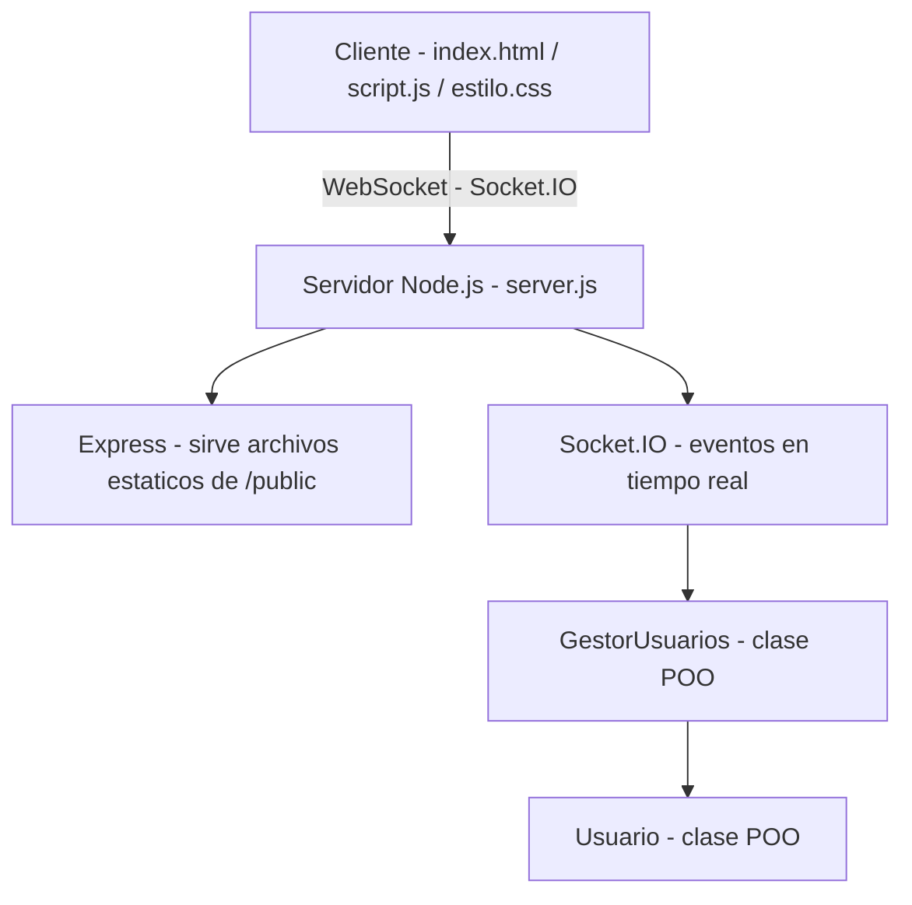
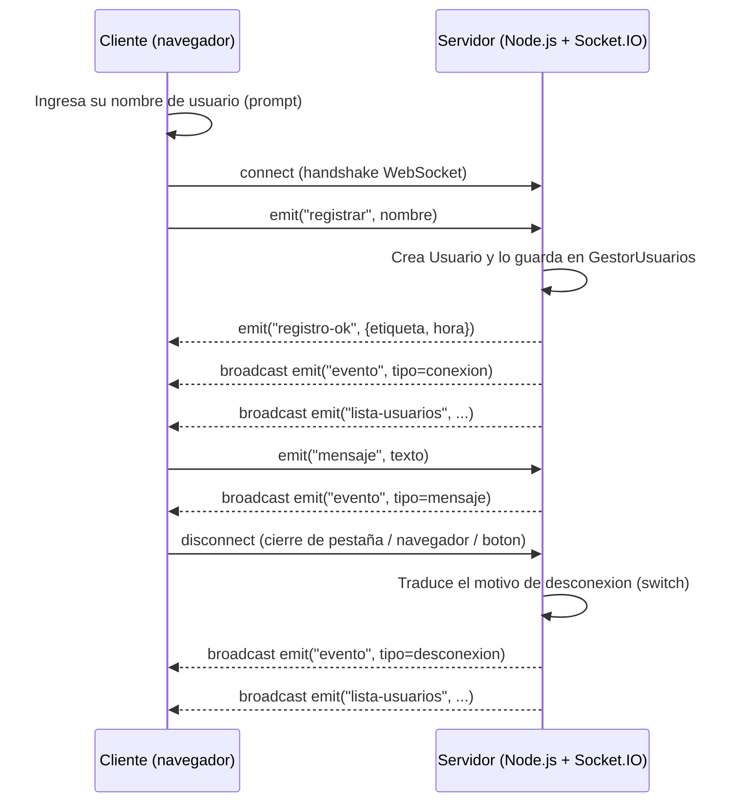
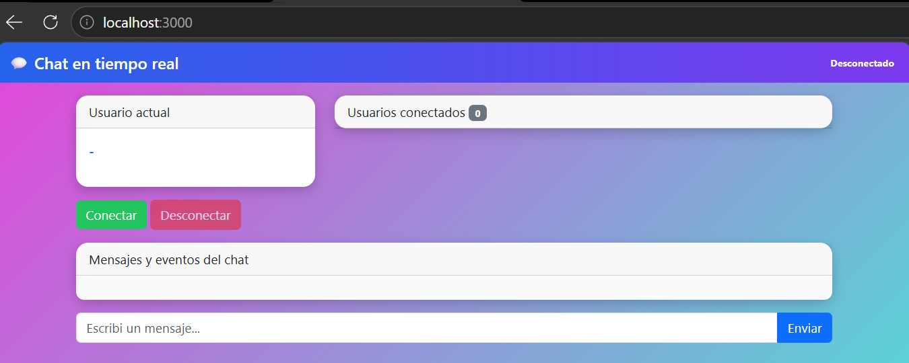
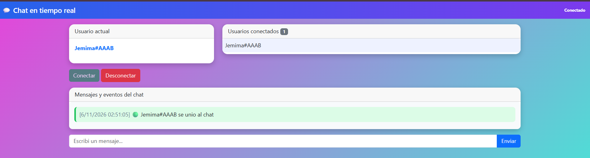
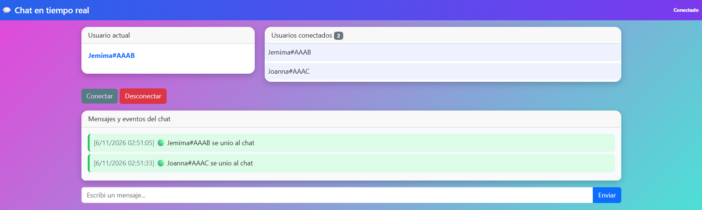
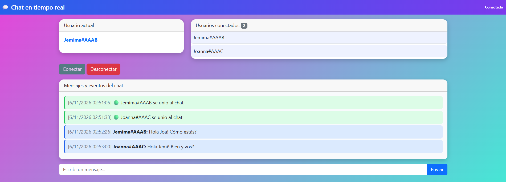
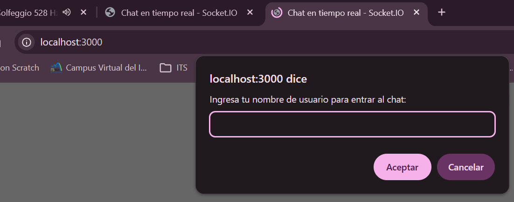
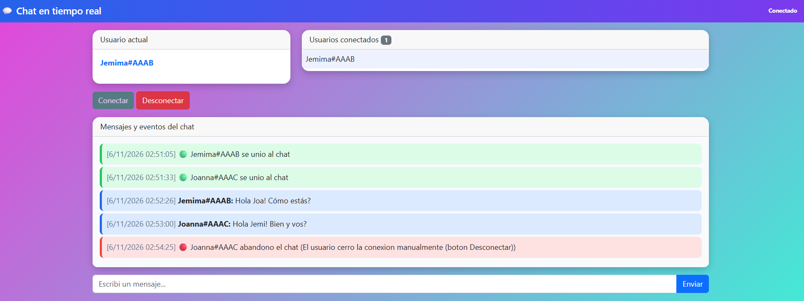
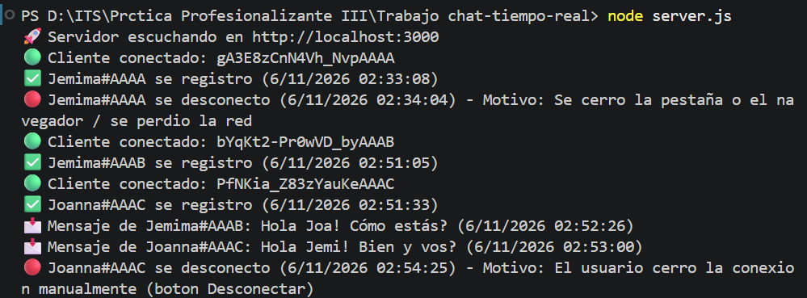

# 💬 Chat en tiempo real con WebSocket/Socket.IO

Trabajo Práctico - Instituto Técnico Superior Cipolletti.

## 1. Nombre del proyecto

**chat-tiempo-real**

## 2. Descripción

Aplicación web de chat en tiempo real que permite a varios usuarios comunicarse
de manera simultánea a través de **WebSocket**, usando la librería **Socket.IO**.

El usuario elige un nombre antes de ingresar, se le asigna un identificador único
(para poder diferenciarlo de otros usuarios con el mismo nombre), y el sistema
informa en tiempo real los eventos de conexión, desconexión y los mensajes
enviados, mostrando siempre la fecha y hora de cada evento.

## 3. Tecnologías utilizadas

| Tecnología      | Uso                                                        |
|------------------|-------------------------------------------------------------|
| Node.js          | Entorno de ejecución del backend                            |
| Express          | Servidor HTTP, sirve el frontend estático                   |
| Socket.IO        | Comunicación bidireccional en tiempo real (WebSocket)       |
| cors             | Habilitar peticiones desde distintos orígenes                |
| HTML5            | Estructura del frontend                                     |
| CSS3             | Estilos propios del proyecto                                 |
| Bootstrap 5      | Componentes visuales (cards, botones, badges, grillas)       |
| JavaScript (ES6) | Lógica de cliente y servidor                                 |
| pnpm             | Gestor de paquetes                                           |
| Git              | Control de versiones                                         |

## 4. Funcionalidades

- Ingreso al chat eligiendo un nombre de usuario.
- Identificación única de cada usuario (aunque se repita el nombre elegido),
  combinando el nombre con parte del `id` del socket. Ej: `Juan#a1B2`.
- Aviso en tiempo real cuando un usuario se conecta (nombre + fecha/hora).
- Aviso en tiempo real cuando un usuario se desconecta (nombre + fecha/hora).
- Identificación del **motivo** de la desconexión (cierre de pestaña, cierre de
  navegador, botón "Desconectar", pérdida de conexión, etc.), impreso en la
  consola del servidor junto con el usuario, fecha y hora.
- Envío y recepción de mensajes de chat entre todos los usuarios conectados.
- Listado de usuarios conectados actualizado en tiempo real.
- Todos los eventos (mensajes, conexiones, desconexiones) se muestran en el
  frontend con su hora correspondiente y con un color distinto según el tipo
  de evento.
- Manejo de errores con `try/catch` tanto en el cliente como en el servidor.

## 5. Estructura del proyecto

```
chat-tiempo-real/
├── server.js              # Backend: Express + Socket.IO
├── package.json
├── .gitignore
├── README.md
└── public/
    ├── index.html          # Estructura del frontend
    ├── css/
    │   └── estilo.css      # Estilos propios
    ├── js/
    │   └── script.js       # Lógica del cliente
    └── img/                # Capturas de pantalla (ver punto 12)
```

## 6. Requisitos

- Node.js instalado (versión 18 o superior recomendada).
- pnpm instalado globalmente. Si no lo tenés:
  ```
  npm install -g pnpm
  ```

## 7. Instalación

Clonar o copiar la carpeta del proyecto y, parado en la raíz del mismo, ejecutar:

```
pnpm install
```

Esto instala las dependencias declaradas en `package.json`
(`express`, `socket.io`, `cors` y `nodemon` como dependencia de desarrollo).

## 8. Ejecución

Para iniciar el servidor:

```
pnpm start
```

o, en modo desarrollo (reinicia el servidor automáticamente ante cambios):

```
pnpm dev
```

Luego abrir el navegador en:

```
http://localhost:3000
```

Para probar el chat con varios usuarios, abrir varias pestañas o navegadores
distintos apuntando a la misma URL.

## 9. Funcionamiento

1. Al abrir la página, el navegador pide (con un `prompt`) el nombre de usuario.
2. Al presionar **Conectar**, el cliente abre la conexión WebSocket contra el
   servidor y se registra enviando su nombre.
3. El servidor crea una instancia de la clase `Usuario`, le asigna un
   identificador único y lo guarda en el `GestorUsuarios`.
4. El servidor avisa a todos los clientes conectados que un nuevo usuario
   ingresó, y envía la lista actualizada de usuarios conectados.
5. Cada mensaje enviado por un cliente es reenviado por el servidor a todos
   los usuarios conectados (broadcast), junto con la fecha y hora.
6. Al desconectarse un usuario (por cualquier motivo), el servidor detecta
   la razón, la traduce a un mensaje legible, la imprime por consola y
   notifica a todos los clientes restantes.

## 10. Comunicación mediante WebSocket/Socket.IO

### Eventos del cliente hacia el servidor

| Evento       | Datos que envía              | Descripción                             |
|--------------|-------------------------------|------------------------------------------|
| `registrar`  | `nombre` (string)             | Registra al usuario al conectarse         |
| `mensaje`    | `texto` (string)               | Envía un mensaje de chat                  |

### Eventos del servidor hacia el cliente

| Evento           | Datos que envía                                   | Descripción                                    |
|-------------------|----------------------------------------------------|--------------------------------------------------|
| `registro-ok`      | `{ etiqueta, hora }`                                | Confirma el registro y entrega el id único        |
| `evento`           | `{ tipo, usuario, hora, mensaje }`                  | Mensaje de chat, ingreso o egreso de un usuario   |
| `lista-usuarios`   | `{ usuarios: [], total }`                           | Lista actualizada de usuarios conectados          |
| `error-servidor`   | mensaje (string)                                    | Informa un error controlado al cliente            |

## 11. Diagrama de arquitectura (Mermaid)

### Componentes del sistema



### Secuencia de eventos



## 12. Capturas de pantalla
- Pantalla inicial

- Usuario conectado

- Dos usuarios conectados

- Mensajes enviados

- Ingreso de usuario

- Desconexión de usuario

- Consola del servidor

- README renderizado en StackEdit


## 13. Pruebas realizadas

Durante el desarrollo se probó, abriendo varias pestañas/navegadores contra
`http://localhost:3000`:

- Conexión de un usuario y verificación del aviso de ingreso.
- Conexión de dos usuarios con el **mismo nombre**, verificando que cada uno
  recibe una etiqueta distinta (`Juan#aaaa`, `Juan#bbbb`).
- Envío de mensajes y verificación de que llegan a todos los clientes.
- Desconexión usando el botón **Desconectar**.
- Cierre de la pestaña del navegador.
- Cierre completo del navegador.
- Recarga de la página (F5).
- En todos los casos anteriores se verificó en la consola del servidor que
  se imprime el usuario, la fecha/hora y el motivo de la desconexión.

## 14. Problemas conocidos

- Si dos usuarios se conectan en el mismo milisegundo exacto y sus `id` de
  socket comparten los últimos 4 caracteres, la etiqueta podría coincidir
  (probabilidad extremadamente baja, pero no es un identificador criptográfico).
- No hay persistencia de mensajes: si un usuario se conecta más tarde, no ve
  el historial de mensajes anteriores.

## 15. Mejoras futuras

- Persistir el historial de mensajes (por ejemplo, en un archivo o base de datos).
- Agregar salas o canales de chat separados.
- Agregar notificación de "usuario escribiendo...".
- Agregar autenticación real de usuarios.

## 16. Autores

- Estudiantes: Arellano, Joanna y Jofré, Jemima
- Materia: Práctica Profesionalizante III
- Institución: Instituto Técnico Superior Cipolletti

---

## Historial de commits

| # | Commit    | Cambios realizados                                                          |
|---|-----------|-------------------------------------------------------------------------------|
| 1 | `ee71b43` | Estructura inicial del chat en tiempo real.                             |
| 2 | `6cadbb2` | Incorporación de capturas y documentación final.                    |

### Tags

- `v1.0.0`: versión inicial del proyecto.
- `v1.1.0`: versión con funcionalidades completas del chat.
- `v2.0.0`: versión final documentada y lista para entregar.

Para ver el historial completo:

```
git log --oneline --graph --decorate
git tag
```
